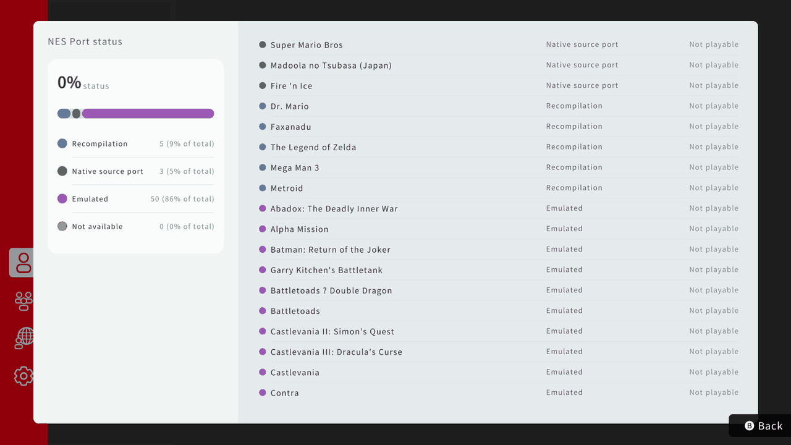

# NSO

NSO is a Nintendo Switch Online-style launcher, written in C with Raylib.
This release plays emulated games with the bundled Mednafen: NES, SNES, and
Mega Drive. (N64 and GameCube have no Mednafen core and are hidden in the
release build.) Put legally obtained ROMs in each system's folder under `roms/`.
Cover images are not shipped; scrape them from the Emulated tab of the
status menu (S).

This repository does not include ROMs or copyrighted art. You must supply your
own legally obtained ROMs. Cover images are fetched or added locally; a missing
cover is shown as a "?" placeholder.

## Install (end users)

Extract the release tarball (`nso-<version>-linux-x86_64.tar.gz`) into its own
folder. You should have:

- `nso` — the launcher (self-contained; UI fonts and system cards are embedded)
- `mednafen` — the bundled emulator (must sit next to `nso`; there is no
  system-Mednafen fallback)
- `nso-norumble.so` — used automatically when Rumble is turned off
- `README.md`

Put legally obtained ROMs next to the binary, in a per-system folder:

```
roms/NES/
roms/SNES/
roms/MegaDrive/
```

Loose files and per-game subfolders are both fine. Then run `./nso` from that
folder (or double-click it). Paths are resolved next to the executable, not
from the current working directory (`NSO_BASE_DIR` can override that).

On the first run NSO creates `config/` (settings, dates, custom order) next to
the binary. Covers you scrape are saved under `assets/images/systems/<system>/`.
You need `curl` only to scrape box art. OpenGL and X11 are required.

If `mednafen` is missing from that folder, starting a game shows
"Bundled Mednafen is missing" instead of doing nothing.

## What's new (Novidades)

Version 0.2.1 supports emulated games only (NES, SNES, Mega Drive). The full feature list is in
[CHANGELOG.md](CHANGELOG.md). The screenshots below are NSO's own interface
on a clean install, without ROMs or covers (missing covers show a "?").

**Main menu:** the system cards are twice as big.


**Game grid:** sidebar with rail icons and a hint bar that follows the connected
controller (N64 labels on the 8BitDo N64 pad).


**Sort panel (T, hold Y, or C-Right on the N64 pad):** custom order, title,
release date, last played, play time, plus the Favorites and Hide unplayable
filters.


**Statistics (S):** playable share and a per-game list for the current system.
The Emulated tab scrapes box art.



**Image scraping and Hide unplayable:** per-system settings.


**Rewind (NES, SNES):** hold ZL + ZR on the pad or Backspace on the keyboard. The
game shrinks, a panel rises with one thumbnail per second of history, and a caption
bar (with "Show controls in game") shows at game start and while rewinding. Shots
of it show game frames, so they are not included here.

## Build

You need:

- A C23 compiler: GCC 14+ or Clang 18+ (the Makefile uses `-std=c23`).
- GNU Make.
- [Raylib](https://www.raylib.com/) **6.0 or newer** (NSO uses `FileMove` and
  `FileRemove`, which Raylib 5.5 and older do not have). The Makefile links
  with plain `-lraylib -lm`, so the library must be on the default linker path.
- At run time: `curl` (cover scraping) and `git` (repository downloads).

Distro packages (compiler, make, curl, git, and what Raylib needs to build):

| Distro | Command |
| --- | --- |
| Gentoo | `emerge --ask sys-devel/gcc dev-build/make net-misc/curl dev-vcs/git dev-build/cmake x11-libs/libX11 x11-libs/libXrandr x11-libs/libXinerama x11-libs/libXcursor x11-libs/libXi media-libs/mesa` |
| Debian / Ubuntu | `sudo apt install build-essential curl git cmake libx11-dev libxrandr-dev libxinerama-dev libxcursor-dev libxi-dev libgl1-mesa-dev` |
| Arch | `sudo pacman -S --needed base-devel curl git cmake libx11 libxrandr libxinerama libxcursor libxi mesa` (or `raylib` if the repo package is 6.0+) |
| Fedora | `sudo dnf install gcc make curl git cmake libX11-devel libXrandr-devel libXinerama-devel libXcursor-devel libXi-devel mesa-libGL-devel` |

Most distros still ship Raylib 5.5, so build Raylib from source:

```
git clone --depth 1 https://github.com/raysan5/raylib.git
cmake -S raylib -B raylib/build -DBUILD_SHARED_LIBS=ON -DBUILD_EXAMPLES=OFF
cmake --build raylib/build -j"$(nproc)"
sudo cmake --install raylib/build     # installs to /usr/local
sudo ldconfig                         # if /usr/local/lib64 is new to the loader
```

Then build and test NSO:

```
git clone https://github.com/Vulto/nso.git
cd nso
make
make test
./nso
```

`make release` produces `dist/nso-<version>-linux-x86_64.tar.gz` with `nso`,
the bundled `mednafen`, and `nso-norumble.so`. NSO's fonts, main-menu system
cards, UI art and the CRT Geometry shader are embedded in `nso`, and Raylib is
linked statically. Scrapable game box arts are not embedded; users scrape
covers themselves. glibc, OpenGL and X11 remain dynamic (Mednafen also keeps
SDL2, ALSA, libFLAC and zlib dynamic). The ordinary `make` / `./nso` developer
build is unchanged and still loads those assets from the tree.

`./nso` works from any directory: data paths are resolved next to the binary
(override with `NSO_BASE_DIR=/path/to/nso`). NSO creates `config/` on the first
run, and `assets/cache`, `assets/images/...`, `repos/`, `logs/` and `saves/` as
needed.

## Usage

| Action | Keyboard | Gamepad (Nintendo layout) |
| --- | --- | --- |
| Move | Arrow keys | D-pad / stick |
| Confirm / start game | Enter | A (right face) or Start |
| Back | B (or Backspace) | B (bottom face) |
| Move a game (hold to sort, arrows move it) | Y (hold) | Y |
| Game details panel | X | X |
| Status menu (tabs, including Emulated scraping) | S | (also from the in-game Home menu) |
| Cycle status-menu tabs | Y | Y |
| Organization sidebar | O | |
| Sort panel | T (or hold Y) | C-Right on the N64 pad |

On the main menu, Down moves to the dock: **Downloads** (the self-updater) and
**Power**. Power opens a dialog with **Shut down**, **Close NSO**, and
**Cancel** (Cancel is the default).

**Updates.** The release build checks the latest Vulto/nso GitHub release in the
background at startup (silent when offline, never blocks the UI). If its tag is
newer than the running version, the Downloads icon glows, and while the cursor
is on it a short note says which version is available. Pressing it downloads the
release's linux tarball, verifies it (SHA-256 when GitHub publishes one, plus
structure and ELF checks), swaps `nso`, the bundled `mednafen` and
`nso-norumble.so` in with atomic renames (rolled back on failure) and restarts
NSO. With no update the button does nothing. Source/dev builds never self-update.
`NSO_UPDATE_API` overrides the API URL (a `file://` JSON works) for testing.

In the status menu's **Emulated** tab, **Download all box arts** scrapes a
cover for every detected ROM, and **Select games** lets you pick a subset
(with a preview of the focused candidate). Covers come from the per-system
[libretro-thumbnails](https://github.com/libretro-thumbnails) repos.

In supported ports (the patched SNES games) F5 saves a state without leaving
and F12 (or Home) saves and returns to NSO.

On Linux/X11, child-process games also share NSO's in-game menu: press End or
the controller Guide button to Continue, Reset Game, or return To Game
Selection. Embedded games keep their module menu and suspend-point support.

To Game Selection leaves the game paused in the background (one game at a
time). Starting it again resumes it where it was.
Starting a different game first asks "Close <game>?": Yes (A / Enter) closes
the paused game and starts the new one, No (B / Backspace) goes back to the
grid. Quitting NSO closes the paused game too.

While a Mednafen game or a reparented port owns the screen, NSO stops
redrawing the 1920×1080 4×-MSAA grid and waits on input (End still opens
the menu, and the enter/leave animations still play). Embedded modules
keep the game loop and only skip that extra frontend drawing. While a
game is running, interface images (covers, platform art, and other large
frontend textures) are unloaded to free RAM; the current cover is kept
for the launch and return animations. On the way back, the visible
screen around the cursor is loaded first (during the exit animation),
then the first and last screens of the list, then the middle, without
blocking the menu. The grid is shown only once that visible screen is
complete (the previous frame is held; there is no loading screen). The
same happens at startup, after the existing enter animation.

### Settings

Open a system, press O for the sidebar and pick **Settings** (per-system
options such as Pixel Perfect, Scanlines, CRT Geometry, Show controls and the
controller map). The language is set with `language=pt-BR` (or `en`) in
`config/nso.cfg`. The N64 / GameCube / source-port / recompilation sections
below describe the source tree; the release build hides N64 and GameCube and
the Recompilation / Native source port statistics (build with
`-DNSO_SHOW_ALL_SYSTEMS` to show them).

- **Image scraping:** in the game grid press S and open the **Emulated** tab.
  "Download all box arts" fetches missing covers; "Select games" scrapes a
  chosen subset (with a preview). Covers come from
  [libretro-thumbnails](https://github.com/libretro-thumbnails) (per-system
  GitHub raw files, No-Intro names); no account or API key is needed. They are
  saved to `assets/images/systems/<system>/`. A short message is shown when a
  title has no matching art.
- **Repository download:** pick a port (or "Download all") to clone it into
  `repos/<system>/...` and build it with `tools/repo_sync.sh`. The status column
  shows progress; full logs are in `logs/repos/<name>.log`. Missing build tools
  are listed as "Missing deps: ...". N64 and GameCube ports are large and can take a
  long time to build.
- **Language:** English / Português.
- **CRT Geometry (below Scanlines on NES / SNES; "Game Screen" on N64 / GameCube):** a
  CRT-monitor look (screen curvature, rounded corners, beam scanlines, glow, dot mask)
  from the shader in `shaders/crtgeom.glsl`. It draws inside the picture area picked by
  Pixel Perfect / 4:3, so those keep their sizes. Saved per system as `<system>.crtgeom`
  in `config/nso.cfg` (off by default). A toggles it On or Off. When it is on,
  the shader always uses the faster path (no 3-tap scanline filter, cheaper
  glow, no filmic tone map).
  The shader runs at an internal size of about 960×720 (4:3) into a
  non-MSAA target, then the picture is scaled to the output so the 2-pixel
  phosphor mask stays sharp. Where it applies:
  - **Games NSO draws itself** (the embedded modules: Super Mario Bros, Mega Man 3,
    Super Mario World, Star Fox, Super Mario 64, Majora's Mask, Star Fox 64, AeroGauge),
    including the pause menu's frozen frame, the return-to-grid zoom and the rewind
    overlay: raylib shader, built once at start. NES/SNES: the shader draws the scanlines
    (they follow the Scanlines toggle) instead of the plain dark bands. N64: always with its
    beam scanlines (no Scanlines toggle there).
  - **NES / SNES games run by Mednafen** (all `roms` games): a Mednafen with a small
    patch, `tools/mednafen-nsocrt.patch` (apply to the `mednafen/` tree; an unpatched
    Mednafen fails to start with the toggle on). The rewind overlay uses the same shader,
    so holding rewind does not change the look.
  - **Zelda: Ocarina of Time (Ship of Harkinian):** `tools/soh-nsocrt.patch` (apply with
    `patch -p1` in `repos/n64/soh-src`, then rebuild `soh.elf`) draws the game picture through
    the same shader: ImGui draw-list callbacks around the game image switch to the
    `NSO_RAYLIB` variant of `shaders/crtgeom.glsl`, the game is always rendered into its own
    framebuffer for that, and the picture is sampled as a 480-line source (like the N64
    consoles), so the beam lines look the same at any window size. NSO sets
    `NSO_CRTGEOM_SHADER`, `NSO_CRTGEOM_SCAN` and `NSO_CRTGEOM_PARAMS` for it and the patched
    port re-reads the params file when it changes. The frame NSO captures for its End menu is
    drawn plain by the port, and NSO filters that frozen frame and the preview itself with the
    same 480-line source, so nothing is filtered twice. `nso` looks for the marker
    `nso-crtgeom-hook-v1` in `soh.elf`: an unpatched build keeps the CRT Geometry items hidden
    for Ocarina of Time (the game runs as before).
  - **Mario Kart 64 (SpaghettiKart) and Banjo-Kazooie (Lighthouse):** the same libultraship
    hook as Ocarina of Time, as `tools/spaghettikart-nsocrt.patch` and
    `tools/lighthouse-nsocrt.patch` (`patch -p1` in `repos/n64/spaghettikart` /
    `repos/n64/Lighthouse`, rebuild). These ports use NSO's generic End-menu launcher
    (`nso --menu-launcher`), which stops the game right after End, so the last frame would
    already be filtered. For `crtHook` games the launcher therefore creates the flag file
    `<state dir>/nso-crt-plain` (`NSO_CRTGEOM_PLAIN`), waits up to 2 s for the hook's
    `<flag>.ack` (written after two plain frames), and only then stops the game; "resume"
    removes both files before continuing. Any other libultraship port with the same
    `Fast3dGui.cpp` / `interpreter.cpp` can reuse these patches.
  - **Perfect Dark:** `tools/perfect_dark-nsocrt.patch` (on top of the NSO End-menu bridge
    in `port/src/nso_bridge.cpp`; `patch -p1` in `repos/n64/perfect_dark-src`, rebuild).
    The port has no ImGui, so the hook is a post pass at the buffer swap
    (`port/fast3d/nso_crtgeom.cpp`): the back buffer is copied and redrawn through the
    `NSO_RAYLIB` shader. The bridge asks for two plain frames before it signals NSO.
  - **Not covered** (separate programs with their own window and renderer, NSO cannot
    filter them): NES OpenMadoola, OpenDana (Fire 'n Ice), Dr. Mario, Faxanadu, Zelda,
    Metroid; SNES zelda3, Super Metroid, F-Zero, Go Go Ackman, Kirby Super Star, Super
    Mario All-Stars, Super Mario RPG, Mega Man X2/X3; the N64 ports that are not built
    here or use RT64 / Aurora / Vulkan renderers (recomps, GameCube ports), and Super Smash
    Bros (older libultraship without `Fast3dGui.cpp`). The toggle shows for them but has no
    effect (the item stays hidden in their menus) until the port gets the hook.
  - **Fine settings (End menu > "CRT Geometry"):** with the toggle on, the pause menu of every
    covered game has a "CRT Geometry" item that opens a screen with sliders only (Back returns
    to the list; the toggle on the games screen stays the master on/off): CRT Gamma, Monitor
    Gamma, Overscan, Saturation, Curvature, Distance, Angle, Aspect, Corner Size, Corner
    Smooth, Halation, Filmic (the MAME-PSGS.vsh parameters). Left / Right move a slider (held:
    auto-repeat), the middle of each bar is the stock value (CRT Gamma 2.4, Monitor Gamma 2.2,
    ...). Overscan is one scale for both axes; Aspect scales the y of the shader's aspect
    (middle = the picture's own shape); Angle is the y tilt only and the upstream `const vec2
    angle` stays untouched until you move it; Curvature runs backwards (right = rounder, a
    smaller R). Hold A 0.9 s: this slider returns to the default; on the last row, all of them.
    A live preview of the paused picture sits on the right; Back / End saves and the game
    uses the values when it resumes. Per game in `config/crtgeom/<system>/<title>.cfg`
    (`key=step`, steps 0-40, 20 = stock; an unset key inherits `config/crtgeom/<system>/_default.cfg`,
    a hand-edited file of the same format, then the stock value). Mednafen is a separate
    process: NSO writes the resolved values to `saves/<system>/mednafen/nso-crtgeom.params`
    (`NSO_CRTGEOM_PARAMS`) and the patched Mednafen re-reads it whenever it changes. The
    preview of a Mednafen game uses its raw frame from the rewind shared memory (the End
    menu's screenshot already carries Mednafen's shader).
- **NES / SNES / N64 controller (below the scrape/Hide rows of each):** shows the pad and
  lights each button you press in white. Holding A for 0.9 s starts the mapping (a ring
  fills on the hint bar's A glyph; the holds' controls light only the button they are bound to): it asks for one button at a time (Up, Down, Left,
  Right, Select, Start, B, A; the asked button blinks on the pad): press the key or pad
  button for it (inputs are edge-triggered: release everything between buttons). Esc
  (or 10 s idle) cancels and keeps the old map. Holding ZR (Left Shift on the keyboard) for 0.9 s deletes
  the custom map. Leaving the screen takes holding B for 0.9 s (a ring fills on the B
  glyph); during the mapping, holding a button for 0.9 s skips that prompt and keeps its
  mapping. Saved as `nes.map.*` in `config/nso.cfg` after the last button; it
  applies to Mednafen (via `nes.input.port1.gamepad.*`), the embedded NES games
  and the NESRecomp ports (written to their `config.ini` on launch). OpenMadoola
  and OpenDana keep their own input settings. The SNES screen is the same (Up, Down, Left,
  Right, Select, Start, Y, B, X, A, L, R, ZL, ZR; saved as `snes.map.*`) and it applies to
  Mednafen (`snes.input.port1.gamepad.*`), the embedded SNES games (Super Mario World, Star Fox),
  zelda3 and sm (the `Controls` lines of `zelda3.ini` / `sm.ini`, keys and pad) and the snesrecomp
  ports (`keybinds.ini` `[player1]`: those ports only take keyboard keys, so a mapped pad button
  does not reach them). ZL / ZR are drawn and mappable like the Switch Online pad's, but no SNES
  game reads them, so they are not handed to any game; NSO's own rewind chord is unchanged.
  The N64 screen is the same too (D-pad Up/Down/Left/Right, Stick Up/Down/Left/Right, Start, A, B,
  Z, L, R, C-Up/Down/Left/Right; saved as `n64.map.*`). Z is drawn apart from the body, with a leader
  line to the trigger behind the middle prong. The stick directions are digital (full tilt; the
  analog stick keeps working when none of them is held) and the stick's rings shift with the tilt.
  It applies to the N64 games NSO runs inside its window (the embedded ones: Super Mario 64, Star Fox
  64, ...). The external N64 ports (SoH, Perfect Dark, Ship ports, the recomps ...) read their own
  controller setup through SDL and are not touched, and there is no Mednafen N64 module: set their
  controls in their own menus. A Switch-mode N64 pad (057e:2009 / 2019) keeps its C buttons as the
  right stick everywhere; they light the C directions on this screen too.

### ROMs

NSO never downloads ROMs. When a port needs one the status shows
"ROM needed: <file>"; copy your own dump to the path shown (for example
`repos/nes/smbvanilla/smb.nes`, `repos/snes/smw/smw.sfc`,
`repos/n64/sm64ex/baserom.us.z64`) and run the download again to build it.
Fire 'n Ice (OpenDana) takes the European *Solomon's Key 2* ROM dropped directly
in `repos/nes/opendana/`; it is imported on first launch.

### System images

System art is not included. Without it the main menu and the system splash
show the console name as text. To use your own art, save a 1920x1080 PNG at:

- `assets/images/systems/nes/nes.png`
- `assets/images/systems/snes/snes.png`
- `assets/images/systems/n64/n64.png`
- `assets/images/systems/gamecube/gamecube.png`

The menu card shows a square centre crop of the image. The gear icon
(`assets/images/ui/gear.png`, optional) falls back to a drawn gear.

## Supported projects

The launcher can clone, build, and launch the following source ports (see
`src/repos.h`):

**SNES:** smw, zelda3, sm

**NES:** SMB Vanilla, OpenMadoola, OpenDana

**N64:** sm64ex, Ship of Harkinian, 2 Ship 2 Harkinian, Perfect Dark, SpaghettiKart

**GameCube:** Dusklight, melee-pc, Metroid Prime, Paper Cut

**Zelda Ocarina of Time (Ship of Harkinian):** build the checked-out source with
`make soh-nso`. In game, F5 saves to an NSO suspend point, F6 changes the slot,
and F7 loads it. Press End or the controller Guide button to open the same NSO
pause menu used by the embedded games, with Continue, Load/Create Suspend Point,
Restart, and To Game Selection.
Open the NSO Save States panel to resume a point on the next launch.
SoH's snapshots keep SoH's own limitation: they can fail across scene and
load-zone transitions.

**Perfect Dark:** on Linux/X11, End or the controller Guide button opens NSO's
shared pause menu. Continue resumes; Restart relaunches the game; To Game
Selection exits to NSO. In-game suspend points are unavailable because the
port does not provide a safe live-session snapshot.

**Star Fox (SNES):** runs as an in-process module and uses NSO's pause menu
and suspend-point slots. Set `snes.starfox_rom` in `config/nso.cfg` to your
ROM; `make embed` builds the module alongside the other embedded games.

### Static recompilations

Also built from source (never prebuilt releases), from the static
recompilations listed on
[retroreversing.com](https://www.retroreversing.com/source-code/decompiled-retail-console-games)
that document a Linux build. Each needs your own ROM dump: put it in the
game's `repos/<system>/<game>-recomp/` folder under the name the gear screen
shows (NES ones need no ROM to build and ask for it when the game starts).

**SNES:** F-Zero, Go Go Ackman, Kirby Super Star, Super Mario All-Stars,
Super Mario RPG, Mega Man X2, Mega Man X3

**NES:** Dr. Mario, Faxanadu, The Legend of Zelda, Mega Man 3, Metroid

**N64:** Bomberman 64, Bomberman Hero, Chameleon Twist, Donkey Kong 64,
Dr. Mario 64, Duke Nukem: Zero Hour, Extreme-G, Harvest Moon 64, Mystical
Ninja Starring Goemon, Quest 64, Snowboard Kids, Snowboard Kids 2, Space
Station Silicon Valley, Mega Man 64, Sin and Punishment, BattleTanx: Global
Assault, Battlezone: Rise of the Black Dogs, Turok: Rage Wars, Yoshi's Story,
Pilotwings 64, Body Harvest, Hybrid Heaven, Wave Race 64, GoldenEye 007, Jet
Force Gemini, Conker's Bad Fur Day, Banjo-Tooie

Most N64 ones need `clang`, `lld` (`ld.lld`), `cmake`, `ninja`, SDL2 and
GTK 3; GoldenEye 007 also needs `xdelta3`. A missing tool is reported in the
gear screen before anything is built.

## Third-party font

`assets/fonts/NotoSansCJKkr-Regular.otf` is Noto Sans CJK by Google/Adobe, licensed under the SIL Open Font License 1.1 (see `assets/fonts/LICENSE-NotoSansCJK.txt`).

## Third-party shader

`shaders/crtgeom.glsl` is derived from [MAME-PSGS](https://github.com/TheCodeTherapy/MAME-PSGS)
by Marco Gomez (@TheCodeTherapy), licensed under the Apache License 2.0, itself
based on the CRT-geom shader family. Changes (single-file port, uniforms, beam
scanline control, no palette emulation) are listed in the file header.
