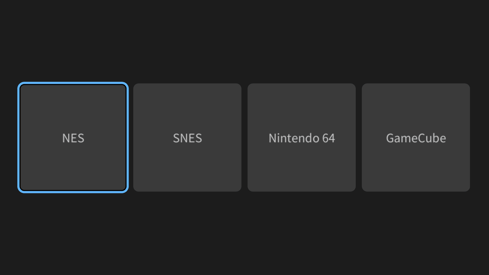
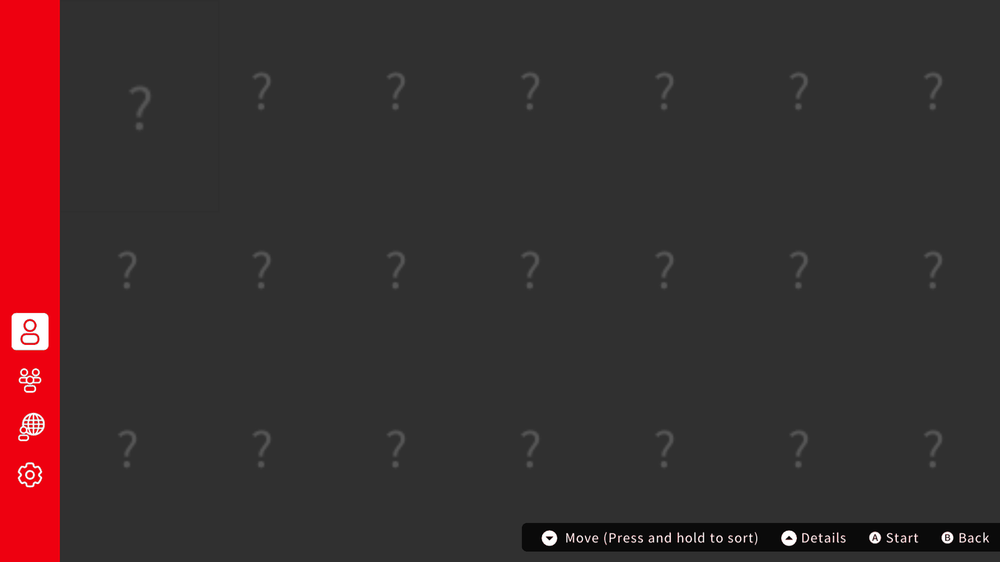
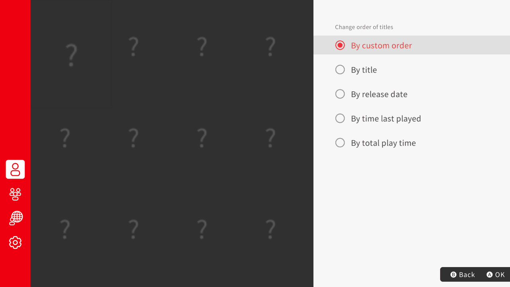
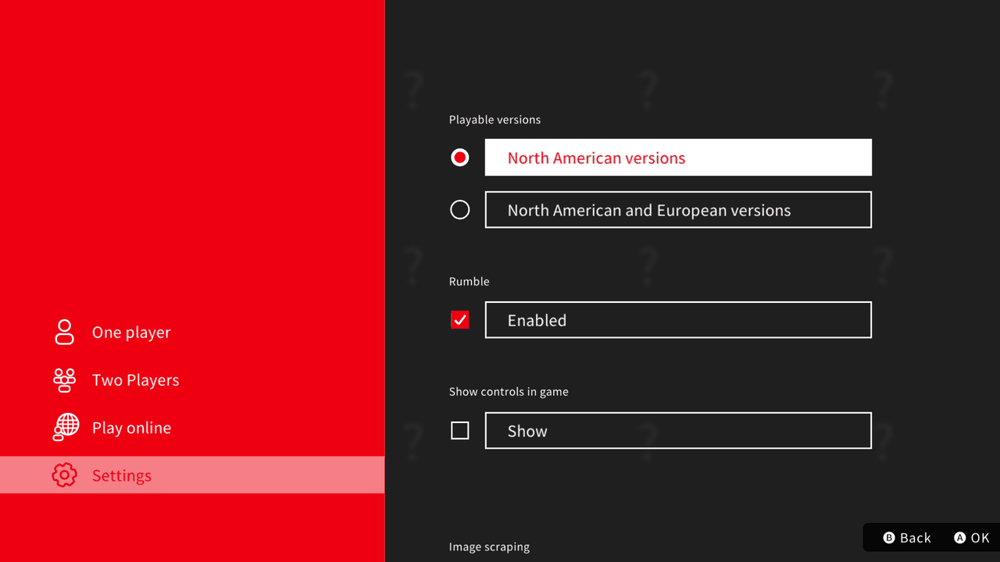
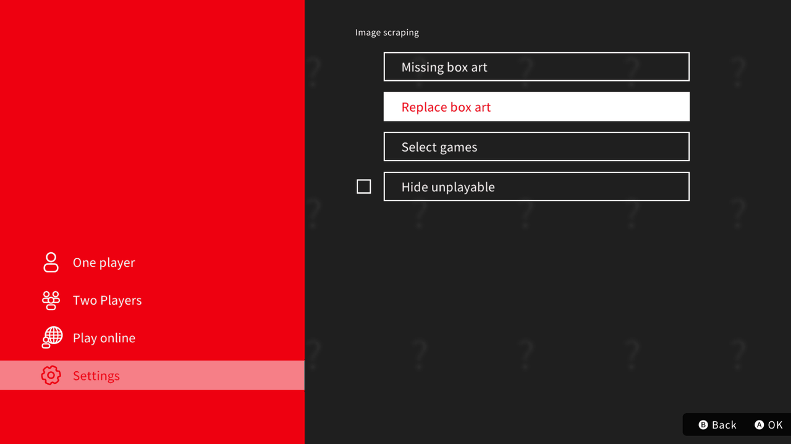

# NSO

NSO is a Nintendo Switch Online-style launcher, written in C with Raylib, for
source ports and decompilations of NES, SNES, N64, and GameCube games.

This repository does not include ROMs or copyrighted art. You must supply your
own legally obtained ROMs. Cover images are fetched or added locally; a missing
cover is shown as a "?" placeholder.

## What's new (Novidades)

Version 0.2.0. The full list is in [CHANGELOG.md](CHANGELOG.md). The screenshots
below are NSO's own interface on a clean install, without ROMs or covers (missing
covers show a "?").

**Main menu:** the system cards are twice as big.



**Game grid:** sidebar with rail icons and a hint bar that follows the connected
controller (N64 labels on the 8BitDo N64 pad).



**Sort panel (T, or C-Right on the N64 pad):** custom order, title, release date,
last played, play time.



**Port status (S):** counts per port type and a per-game list for the current system.


**Nintendo 64 settings:** the Rumble setting now works on the 8BitDo N64 pad
(S mode, USB). "Show controls in game" turns the caption bar on.



**Image scraping and Hide unplayable:** per-system settings.



**Rewind (NES, SNES):** hold ZL + ZR on the pad or Backspace on the keyboard. The
game shrinks, a panel rises with one thumbnail per second of history, and a caption
bar (with "Show controls in game") shows at game start and while rewinding. Shots
of it show game frames, so they are not included here.

## Build

You need:

- A C23 compiler: GCC 14+ or Clang 18+ (the Makefile uses `-std=c23`).
- GNU Make.
- [Raylib](https://www.raylib.com/) **6.0 or newer** (NSO uses `FileMove` and
  `FileRemove`, which Raylib 5.5 and older do not have). The Makefile links
  with plain `-lraylib -lm`, so the library must be on the default linker path.
- At run time: `curl` (cover scraping) and `git` (repository downloads).

Distro packages (compiler, make, curl, git, and what Raylib needs to build):

| Distro | Command |
| --- | --- |
| Gentoo | `emerge --ask sys-devel/gcc dev-build/make net-misc/curl dev-vcs/git dev-build/cmake x11-libs/libX11 x11-libs/libXrandr x11-libs/libXinerama x11-libs/libXcursor x11-libs/libXi media-libs/mesa` |
| Debian / Ubuntu | `sudo apt install build-essential curl git cmake libx11-dev libxrandr-dev libxinerama-dev libxcursor-dev libxi-dev libgl1-mesa-dev` |
| Arch | `sudo pacman -S --needed base-devel curl git cmake libx11 libxrandr libxinerama libxcursor libxi mesa` (or `raylib` if the repo package is 6.0+) |
| Fedora | `sudo dnf install gcc make curl git cmake libX11-devel libXrandr-devel libXinerama-devel libXcursor-devel libXi-devel mesa-libGL-devel` |

Most distros still ship Raylib 5.5, so build Raylib from source:

```
git clone --depth 1 https://github.com/raysan5/raylib.git
cmake -S raylib -B raylib/build -DBUILD_SHARED_LIBS=ON -DBUILD_EXAMPLES=OFF
cmake --build raylib/build -j"$(nproc)"
sudo cmake --install raylib/build     # installs to /usr/local
sudo ldconfig                         # if /usr/local/lib64 is new to the loader
```

Then build and test NSO:

```
git clone https://github.com/Vulto/nso.git
cd nso
make
make test
./nso
```

`./nso` works from any directory: data paths are resolved next to the binary
(override with `NSO_BASE_DIR=/path/to/nso`). NSO creates `assets/cache`,
`assets/images/...`, `repos/`, `logs/`, `config/` and `saves/` as needed.

## Usage

| Action | Keyboard | Gamepad (Nintendo layout) |
| --- | --- | --- |
| Move | Arrow keys | D-pad / stick |
| Confirm / start game | Enter | A (right face) or Start |
| Back | B | B (bottom face) |
| Move a game (hold to sort, arrows move it) | Y (hold) | Y |
| Game details panel | X | X |
| Save states of the selected game | S | (from the Details panel) |
| Organization sidebar | O | |

In supported ports (the patched SNES games) F5 saves a state without leaving
and F12 (or Home) saves and returns to NSO.

On Linux/X11, child-process games also share NSO's in-game menu: press End or
the controller Guide button to Continue, Reset Game, or return To Game
Selection. Embedded games keep their module menu and suspend-point support.

### Settings screen (gear icon)

On the main menu press Down to select the gear, then Enter/A. Left/Right
switches system (NES, SNES, Nintendo 64, GameCube).

- **Image scraping:** "Missing box art" downloads covers that are not on disk;
  "Replace box art" downloads all of them again. Covers come from
  [libretro-thumbnails](https://github.com/libretro-thumbnails) (index via the
  GitHub API, images from `thumbnails.libretro.com`); no account or API key is
  needed. They are saved to `assets/images/systems/<system>/`.
- **Repository download:** pick a port (or "Download all") to clone it into
  `repos/<system>/...` and build it with `tools/repo_sync.sh`. The status column
  shows progress; full logs are in `logs/repos/<name>.log`. Missing build tools
  are listed as "Missing deps: ...". N64 and GameCube ports are large and can take a
  long time to build.
- **Language:** English / Português.
- **NES controller (NES only, below the scrape/Hide rows):** shows the pad and
  lights each button you press in white. Holding A for 0.9 s starts the mapping (a ring
  fills on the hint bar's A glyph; A and B also light the pad while held): it asks for one button at a time (Up, Down, Left,
  Right, Select, Start, B, A; the asked button blinks on the pad): press the key or pad
  button for it (inputs are edge-triggered: release everything between buttons). Esc
  (or 10 s idle) cancels and keeps the old map. Holding ZR (Left Shift on the keyboard) for 0.9 s deletes
  the custom map. Leaving the screen takes holding B for 0.9 s (a ring fills on the B
  glyph); during the mapping, holding a button for 0.9 s skips that prompt and keeps its
  mapping. Saved as `nes.map.*` in `config/nso.cfg` after the last button; it
  applies to Mednafen (via `nes.input.port1.gamepad.*`), the embedded NES games
  and the NESRecomp ports (written to their `config.ini` on launch). OpenMadoola
  and OpenDana keep their own input settings.

### ROMs

NSO never downloads ROMs. When a port needs one the status shows
"ROM needed: <file>"; copy your own dump to the path shown (for example
`repos/nes/smbvanilla/smb.nes`, `repos/snes/smw/smw.sfc`,
`repos/n64/sm64ex/baserom.us.z64`) and run the download again to build it.
Fire 'n Ice (OpenDana) takes the European *Solomon's Key 2* ROM dropped directly
in `repos/nes/opendana/`; it is imported on first launch.

### System images

System art is not included. Without it the main menu and the system splash
show the console name as text. To use your own art, save a 1920x1080 PNG at:

- `assets/images/systems/nes/nes.png`
- `assets/images/systems/snes/snes.png`
- `assets/images/systems/n64/n64.png`
- `assets/images/systems/gamecube/gamecube.png`

The menu card shows a square centre crop of the image. The gear icon
(`assets/images/ui/gear.png`, optional) falls back to a drawn gear.

## Supported projects

The launcher can clone, build, and launch the following source ports (see
`src/repos.h`):

**SNES:** smw, zelda3, sm

**NES:** SMB Vanilla, OpenMadoola, OpenDana

**N64:** sm64ex, Ship of Harkinian, 2 Ship 2 Harkinian, Perfect Dark, SpaghettiKart

**GameCube:** Dusklight, melee-pc, Metroid Prime, Paper Cut

**Zelda Ocarina of Time (Ship of Harkinian):** build the checked-out source with
`make soh-nso`. In game, F5 saves to an NSO suspend point, F6 changes the slot,
and F7 loads it. Press End or the controller Guide button to open the same NSO
pause menu used by the embedded games, with Continue, Load/Create Suspend Point,
Restart, and To Game Selection.
Open the NSO Save States panel to resume a point on the next launch.
SoH's snapshots keep SoH's own limitation: they can fail across scene and
load-zone transitions.

**Perfect Dark:** on Linux/X11, End or the controller Guide button opens NSO's
shared pause menu. Continue resumes; Restart relaunches the game; To Game
Selection exits to NSO. In-game suspend points are unavailable because the
port does not provide a safe live-session snapshot.

**Star Fox (SNES):** runs as an in-process module and uses NSO's pause menu
and suspend-point slots. Set `snes.starfox_rom` in `config/nso.cfg` to your
ROM; `make embed` builds the module alongside the other embedded games.

### Static recompilations

Also built from source (never prebuilt releases), from the static
recompilations listed on
[retroreversing.com](https://www.retroreversing.com/source-code/decompiled-retail-console-games)
that document a Linux build. Each needs your own ROM dump: put it in the
game's `repos/<system>/<game>-recomp/` folder under the name the gear screen
shows (NES ones need no ROM to build and ask for it when the game starts).

**SNES:** F-Zero, Go Go Ackman, Kirby Super Star, Super Mario All-Stars,
Super Mario RPG, Mega Man X2, Mega Man X3

**NES:** Dr. Mario, Faxanadu, The Legend of Zelda, Mega Man 3, Metroid

**N64:** Bomberman 64, Bomberman Hero, Chameleon Twist, Donkey Kong 64,
Dr. Mario 64, Duke Nukem: Zero Hour, Extreme-G, Harvest Moon 64, Mystical
Ninja Starring Goemon, Quest 64, Snowboard Kids, Snowboard Kids 2, Space
Station Silicon Valley, Mega Man 64, Sin and Punishment, BattleTanx: Global
Assault, Battlezone: Rise of the Black Dogs, Turok: Rage Wars, Yoshi's Story,
Pilotwings 64, Body Harvest, Hybrid Heaven, Wave Race 64, GoldenEye 007, Jet
Force Gemini, Conker's Bad Fur Day, Banjo-Tooie

Most N64 ones need `clang`, `lld` (`ld.lld`), `cmake`, `ninja`, SDL2 and
GTK 3; GoldenEye 007 also needs `xdelta3`. A missing tool is reported in the
gear screen before anything is built.

## Third-party font

`assets/fonts/NotoSansCJKkr-Regular.otf` is Noto Sans CJK by Google/Adobe, licensed under the SIL Open Font License 1.1 (see `assets/fonts/LICENSE-NotoSansCJK.txt`).
